<picture>
  <source media="(prefers-color-scheme: dark)" srcset="assets/typing-dark.svg">
  <source media="(prefers-color-scheme: light)" srcset="assets/typing-light.svg">
  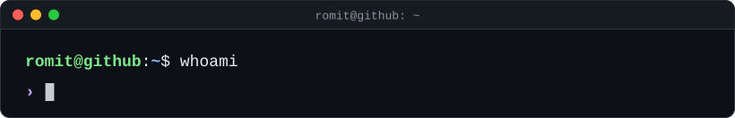
</picture>

Hi, I'm Romit. I'm a computer science undergrad who likes to make and break stuff. I keep exploring new things that come up on the horizon.


### Tools I work with

<table>
<tr><td><samp>Languages</samp></td><td>
<picture><source media="(prefers-color-scheme: dark)" srcset="assets/icons/dark/java.svg">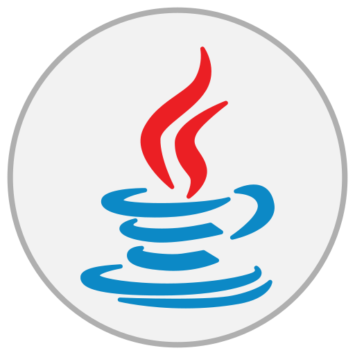</picture>
<picture><source media="(prefers-color-scheme: dark)" srcset="assets/icons/dark/python.svg">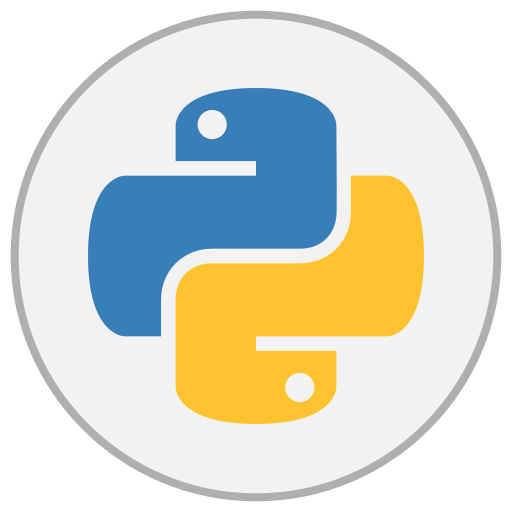</picture>
<picture><source media="(prefers-color-scheme: dark)" srcset="assets/icons/dark/js.svg">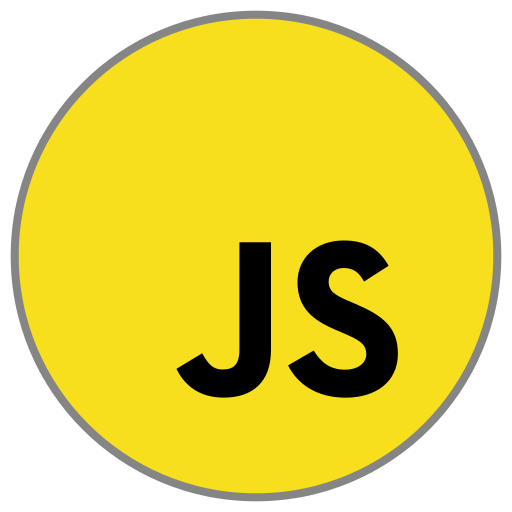</picture>
<picture><source media="(prefers-color-scheme: dark)" srcset="assets/icons/dark/typescript.svg"></picture>
<picture><source media="(prefers-color-scheme: dark)" srcset="assets/icons/dark/sql.svg"></picture>
<picture><source media="(prefers-color-scheme: dark)" srcset="assets/icons/dark/bash.svg">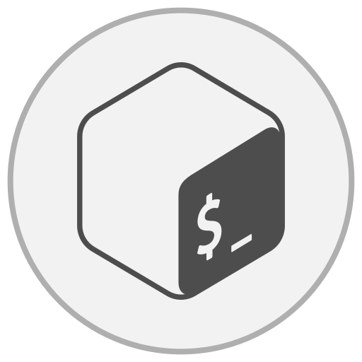</picture>
</td></tr>
<tr><td><samp>Backend &amp; Frameworks</samp></td><td>
<picture><source media="(prefers-color-scheme: dark)" srcset="assets/icons/dark/react.svg">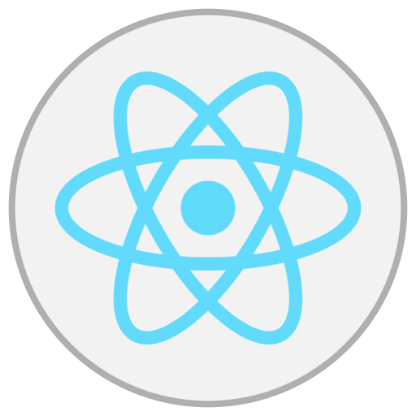</picture>
<picture><source media="(prefers-color-scheme: dark)" srcset="assets/icons/dark/nextjs.svg">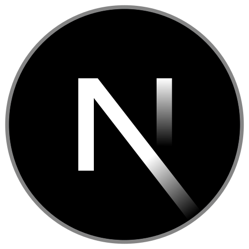</picture>
<picture><source media="(prefers-color-scheme: dark)" srcset="assets/icons/dark/nodejs.svg">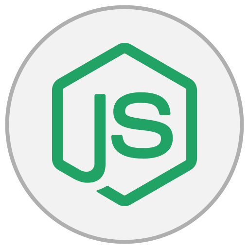</picture>
<picture><source media="(prefers-color-scheme: dark)" srcset="assets/icons/dark/express.svg"></picture>
<picture><source media="(prefers-color-scheme: dark)" srcset="assets/icons/dark/springboot.svg">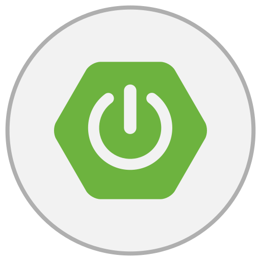</picture>
</td></tr>
<tr><td><samp>Cloud &amp; DevOps</samp></td><td>
<picture><source media="(prefers-color-scheme: dark)" srcset="assets/icons/dark/aws.svg"></picture>
<picture><source media="(prefers-color-scheme: dark)" srcset="assets/icons/dark/docker.svg">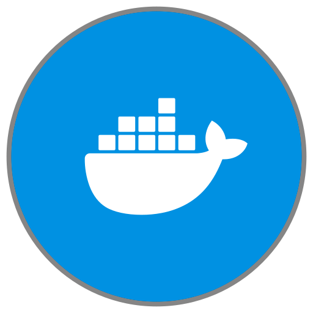</picture>
<picture><source media="(prefers-color-scheme: dark)" srcset="assets/icons/dark/kubernetes.svg"></picture>
<picture><source media="(prefers-color-scheme: dark)" srcset="assets/icons/dark/helm.svg"></picture>
<picture><source media="(prefers-color-scheme: dark)" srcset="assets/icons/dark/terraform.svg">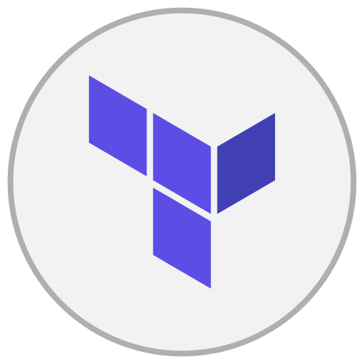</picture>
<picture><source media="(prefers-color-scheme: dark)" srcset="assets/icons/dark/github-actions.svg"></picture>
<picture><source media="(prefers-color-scheme: dark)" srcset="assets/icons/dark/prometheus.svg">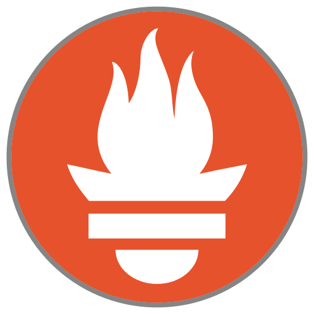</picture>
<picture><source media="(prefers-color-scheme: dark)" srcset="assets/icons/dark/grafana.svg"></picture>
</td></tr>
<tr><td><samp>Databases</samp></td><td>
<picture><source media="(prefers-color-scheme: dark)" srcset="assets/icons/dark/postgresql.svg"></picture>
<picture><source media="(prefers-color-scheme: dark)" srcset="assets/icons/dark/mongodb.svg">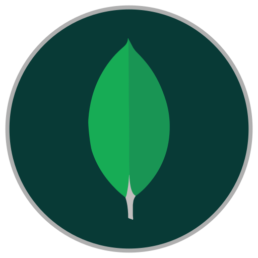</picture>
<picture><source media="(prefers-color-scheme: dark)" srcset="assets/icons/dark/sqlite.svg"></picture>
</td></tr>
<tr><td><samp>Tools</samp></td><td>
<picture><source media="(prefers-color-scheme: dark)" srcset="assets/icons/dark/git.svg">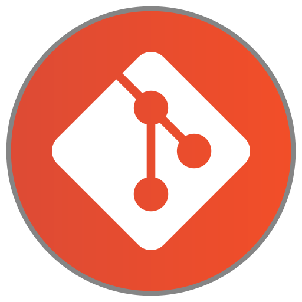</picture>
<picture><source media="(prefers-color-scheme: dark)" srcset="assets/icons/dark/github.svg"></picture>
<picture><source media="(prefers-color-scheme: dark)" srcset="assets/icons/dark/linux.svg"></picture>
<picture><source media="(prefers-color-scheme: dark)" srcset="assets/icons/dark/postman.svg"></picture>
<picture><source media="(prefers-color-scheme: dark)" srcset="assets/icons/dark/vite.svg">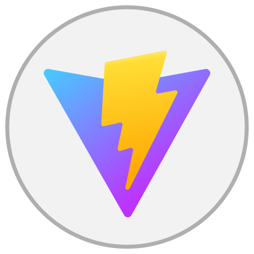</picture>
<picture><source media="(prefers-color-scheme: dark)" srcset="assets/icons/dark/vitest.svg"></picture>
</td></tr>
</table>

### My homelab

<picture>
  <source media="(prefers-color-scheme: dark)" srcset="assets/homelab-dark.svg">
  <source media="(prefers-color-scheme: light)" srcset="assets/homelab-light.svg">
  
</picture>

### A year of commits

<picture>
  <source media="(prefers-color-scheme: dark)" srcset="assets/contrib-city-dark.svg">
  <source media="(prefers-color-scheme: light)" srcset="assets/contrib-city-light.svg">
  
</picture>

### Latest writing

<!-- BLOG-POST-LIST:START -->
- [Server Hardening Guide](https://blog.romitraj.dev/blog/server-hardening-guide) · Sep 14, 2026
- [Why you should own a server](https://blog.romitraj.dev/blog/why-you-should-own-a-server) · Jul 29, 2026
- [Finishing off what I started](https://blog.romitraj.dev/blog/finishing-off-what-i-started) · Mar 30, 2026

<!-- BLOG-POST-LIST:END -->

---

<a href="https://romitraj.dev"><picture><source media="(prefers-color-scheme: dark)" srcset="assets/icons/dark/website.svg"></picture></a>
<a href="https://blog.romitraj.dev"><picture><source media="(prefers-color-scheme: dark)" srcset="assets/icons/dark/blog.svg"></picture></a>
<a href="https://www.linkedin.com/in/romitrajsahu/"><picture><source media="(prefers-color-scheme: dark)" srcset="assets/icons/dark/linkedin.svg"></picture></a>
<a href="https://x.com/brixdorf"><picture><source media="(prefers-color-scheme: dark)" srcset="assets/icons/dark/x.svg">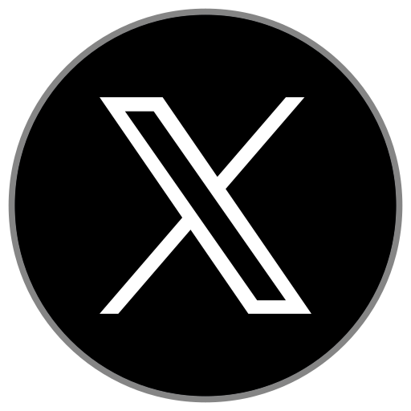</picture></a>

